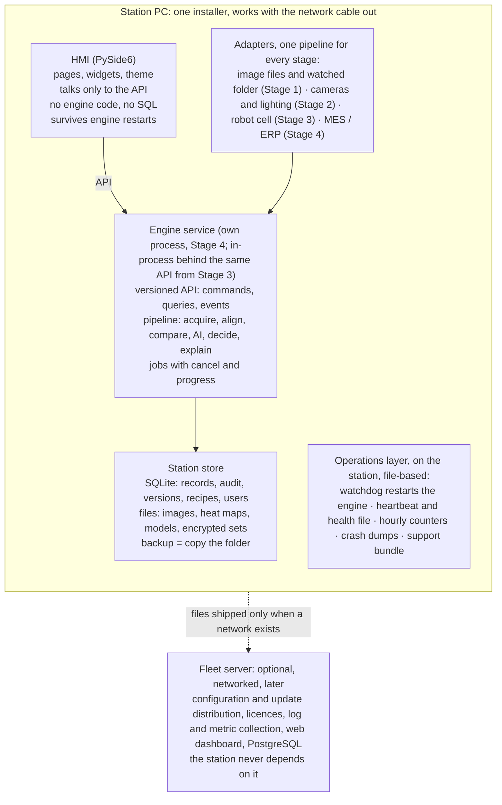

# AOI PoC Inspector: Production-Readiness Review

**As of:** 2026-11-01. **Author:** Jay (product owner), with four independent reviewer agents (architecture, data and reliability, tests and CI, build and operations). **Repository:** `jdseo921/pcb-aoi-monitor` at commit `b5bf413` (2026-10-14). **Questions asked:** are the architecture and service boundaries clear; are documentation and tests adequate; can deployment and monitoring be trusted; could someone else maintain and scale it. **Status of this file:** the diagnosis baseline. Every count and line number below was read at `b5bf413` and must be re-verified at the current head before anything is built on it (see `docs/plans/2026-11-handover-plan.md`, Prompt 0 of the prompt series).

---

## 1. Verdict

**Refactor in place; do not restart.** The foundation is right and unusually well built: an enforced Qt-free engine, a crash-safe data layer with proper migrations, an audit trail enforced by the schema, a job runner whose every rule cites the crash it fixed, 1,009 tests of which 83 % test behaviour, and a supply chain with hash locks, an SBOM and provenance. A restart would throw away exactly the parts that are hardest to get right and would rebuild them more slowly; none of the signals that justify one is present (no framework dead end, no unsalvageable coupling, no missing tests, no ad hoc data model). Four independent reviewers, each told to recommend a restart if warranted, each said no.

What is wrong is real and falls into three groups. First, **policy gaps that would take a station down within days of real use, none of them architectural**: every inspected board is kept as a lossless full-resolution picture forever with nothing checking free space, so a 1 TB disk fills in about a week at one board per ten seconds and the app then refuses its own workspace; the version string has not moved in 181 commits and five schema migrations, so two stations both reporting 0.3.0 can hold incompatible databases; and an I/O fault fails silently, with no heartbeat, no crash dump and no clean-exit marker. Second, **a service layer with no contract**: one 3,787-line class with 144 public methods, 63 of which return untyped dictionaries that the screens index by string in 655 places, and the inspection cycle that a camera or robot must drive living in a Qt page. Third, **a process built for an AI author**: 879 commits in fourteen days, a 75-minute CI run, screenshot approval that needs a Linux machine the owner does not have, a 45-to-90-minute cost for renaming a button, and governing rules that live as chat-tool artifacts outside the repository.

On the question as asked: a web-style frontend, backend, API, services and monitoring stack is the wrong shape for an offline factory station and the right shape, in part, for the product line. Keep one installer per station; inside it, separate the engine from the screen behind one typed, versioned API; add an on-station operations layer; treat the fleet server as a later, separate product the station never depends on.

| Question asked | Answer |
|---|---|
| Architecture and clear service boundaries | Layering: yes, enforced on every pull request. Boundaries: no typed contract, one class as the whole service, the cycle on the wrong side. Stage 3 fixes it in 18 to 25 days |
| Documentation and tests | Content excellent and traceable; form unreadable by a successor; suite large, behavioural and deterministic, but tuned for 36 commits a day. Stage 2 restructures both in 12 to 15 days |
| Monitoring and deployment you can trust | Supply chain better than most; operations a laptop's: no disk guard, no heartbeat, no support bundle, no crash dumps, no version discipline, no fleet story. Stage 1 (G1), 10 to 12 days plus accounts and the line adapter, is the most urgent work |
| Scales and can be maintained by someone else | Not today: a new engineer lands a one-line change in one to two days and must read a 1,477-line draft to begin. After Stages 2 and 3, yes |
| "Works on this device" versus safe to run | The 8-hour soak, 20 power-offs and offline hour have never been run; durability is a proof on paper. No software change replaces the reference PC and a day on it |

## 2. What exists today

A 30,000-line desktop application with a 40,000-line test suite, 27 schema migrations, 23 design records and a 92-row (now 101-row) requirement register, built in about six weeks at roughly 8,000 lines a week. Far past a prototype in substance; prototype marks in shape: one 4,391-line service class with 144 public methods, a user interface of 12,500 lines across nine pages, and an architecture document that calls itself a v0.1 draft.

| Measure | Value | Note |
|---|---|---|
| Application code | 30,056 lines | `aoi/core` 9,418 · `aoi/ui` 16,247 (pages 12,503) · `aoi/data` 1,758 · `aoi/errors.py` 1,763 · `aoi/hal` 271 |
| Tests | 39,728 lines, 1,009 functions, 157 files | 1.3 lines of test per line of code |
| Tools | 4,316 lines, 19 scripts | dataset generator, lock files, SBOM, screenshots, soak, trace matrix |
| Largest unit | `aoi/core/services.py`, 4,391 lines | `AppContext` spans lines 505 to 4291: 203 methods, 144 public |
| Direct dependencies | 5 | PySide6-Essentials, torch, opencv, numpy, cryptography; all hash-pinned |
| Schema | 27 migrations, SQLite | UUIDs on every exported record, UTC times, an audit table with a no-replace trigger |
| Korean UI | 504 of 1,911 strings finished (26 %) | down from 32 % three weeks earlier; no translator is loaded, so the Language setting has no effect |
| Release state | `v0.3.0-rc.1`, unsigned; release gate open on the reference-PC checks, signing and a native reader | no signed build has ever reached a customer |

Since the readiness brief of 2026-10-11 (`ff6b1e0` to `b5bf413`: 174 commits, +25,672 / −2,506 lines): Phase A complete and Phase B through B5 (Trial dataset versions, the store created with the first board model, the "What is missing" checklist, names checked at entry, the first-run guide; PRs #397 to #418, ADRs 0019 to 0023). Not from the brief: master samples each shift, bare-board copper defect names, boxes from annotation files, learning the comparison thresholds, drift control limits (ADRs 0014 to 0018). Not done: B6 to B8, all of Phase C and D. The brief file was never committed.

## 3. Is a frontend / backend / API / services / monitoring stack the right shape?

For the station, no; for the product line, partly. This is an industrial HMI that must run with the network cable out, open no port, give a verdict in under a second, start in five, and run eight-hour shifts on a PC the customer's IT department controls. A browser front end, an HTTP back end, a database daemon and a metrics stack on every station would add four processes to install, patch, start on boot and secure. The current shape, one desktop process with an embedded engine and an embedded database, delivered as one installer, is the correct production architecture for Stages 1 and 2.

| The word in the request | What it should mean on this product | Today |
|---|---|---|
| Backend / services | The inspection engine as its own process with a defined, versioned API, so a crash in PyTorch or OpenCV cannot take the operator's screen down, so a robot cycle or an MES event can drive an inspection with no screen, and so the engine can be tested without Qt | One process. `AppContext` is the API, in-process, 144 methods wide, untyped at the edges |
| APIs | One narrow contract used by the HMI, the robot-cell runner, the MES adapter and the test harness alike: commands, queries, events | The contract exists only as Python method signatures; pages read dictionaries by string key |
| Frontend | PySide6 is the right front end for a touch HMI on an offline PC | Right choice, over-thick: 12,500 lines of page code holding logic that belongs behind the API |
| Database | SQLite on the station; PostgreSQL only for the fleet server, when it exists | Right choice, well handled |
| Monitoring | On-station first and file-based: heartbeat, health file, counters, crash dumps, support bundle, a watchdog; shipping those files to a fleet server when a network exists is a later layer | Structured logs and an audit trail exist; nothing else does |

## 4. Architecture and service boundaries

**Verified strengths.** `core` and `data` import no Qt; `ui` imports no `data` and no `sqlite3`; `tests/test_layers.py:46-69` proves both on every pull request with a source scan and a subprocess import check. `AppContext` is the only place that opens a transaction, checks a role or writes an audit entry; `@requires` puts the acting user in a context variable so a background job keeps acting as the person who started it even after a user switch (`aoi/core/services.py:369-445`, `aoi/core/jobs.py:199`); file work stays outside transactions with compensating deletes on failure (`log_result` at `services.py:1693-1735`, `train` at `1316-1341`). No swallowed exceptions: 32 `except Exception` handlers, every one logging with its trace on a deliberately non-fatal path or returning the error as a value.

| Problem | Measure | Why it matters |
|---|---|---|
| One class is the whole application service | `AppContext` spans `services.py:505-4291`: 3,787 lines, 203 methods (144 public), 53 module constants, 24 UI files importing from the one module | A wide facade over a thin shared core (state partitions cleanly: `_model_cache`, `_keys`, `training`, `_actor`), which is why it still splits cleanly and should be split now |
| No typed contract between screen and service | 63 of 144 public methods return `dict[str, Any]` or lists of them; 0 `TypedDict`s; `Any` 520 times; `ANN401` switched off in `pyproject.toml:12-14`; 655 string-key subscripts in `aoi/ui` (`training_versions.py` 101, `training.py` 97, `model_test.py` 89, `logs.py` 75); job results as positional tuples; 78 of 157 test files reach `ctx.db` directly | A renamed column breaks a page at runtime, caught by a screenshot diff, not the type checker; nothing serialisable exists to put a process boundary on |
| The inspection cycle is page code, and there is no pipeline object | `aoi/ui/pages/inspection.py:296-386` builds and invalidates the engine, loads the image, calls `inspect`, saves the result, detects a moved run and raises four operational alarms; `Inspector.judge` is a hard-coded six-step function with string-named checks (`aoi/core/inspector.py:322-480`); `FolderCamera` is used by no production code; `Camera.grab()` returns a bare array with no timestamp or trigger id (`aoi/hal/__init__.py:26-77`) | A robot cell or a camera loop must either copy a Qt page or extract it first |

**Concurrency and process model.** One `ThreadPoolExecutor` of four workers owned by the context, with progress, cancel and context propagation and no Qt in it (`jobs.py:184-216`); the Qt adapter's weakref and garbage-collection rules each cite the crash they fixed (`aoi/ui/workers.py:56-117`). Every database statement from every thread serialises on one process-wide lock. PyTorch and OpenCV run inside the UI process: a native crash takes the operator's screen down, and nothing restarts it. Two pages can build inspectors that share one cached model object under `no_grad`; fine for inference, written down nowhere.

**Smaller inversions.** `aoi/hal` imports `core.imaging` (`hal/__init__.py:21`); 32 UI files import 54 engine symbols other than the service, several of them functions a page executes (`explain`, `views`, `sample_import`, `recipe`), which `test_layers` does not police; `sqlite3` leaks into `services.py` and `errors.py`; the error catalogue is a 1,400-line Python literal.

**Verdict for this axis: refactor in place, 15 to 22 engineer-days, in this order.** Extract `InspectionCycle` into `aoi/core/cycle.py` (3 to 4 days, first). Split `services.py` into a package of eight concern modules behind the same facade (2 to 3). Type the read API with `TypedDict`s or frozen dataclasses for the fifteen hottest row shapes and re-point the 655 subscripts file by file, `ANN401` back on (4 to 6). Absorb the eleven hand-rolled worker copies into `Page` (1 to 2). Promote `judge` to stage objects only when a Stage 2 check is scheduled. Fix the HAL inversion and the `sqlite3` leak (half a day). Do not touch `db.py`, `atomic.py`, `jobs.py`, `workers.py`, `imaging.py`'s decoder defences, the judging maths, `requires`/`transactional`, or the error model's shape.

## 5. Data layer and runtime reliability

**Verified strengths.** WAL with `synchronous=FULL` and foreign keys on (`aoi/data/db.py:75-82`); every file written as temp, `fsync`, `os.replace`, with a CI scan that refuses any write in `aoi/` that bypasses it (`aoi/data/atomic.py`, `tests/test_power_cut.py:144-152`); files before the row; one serialised SQLite connection behind an `RLock`; a migration runner with contiguous numbering, one transaction per file, SHA-256 checksums, down-level refusal and a backup copy before any change (`aoi/data/migrate.py:96-152`); 31 triggers making the audit and label tables append-only in the schema.

**Three risks for unattended use.**

1. **Disk exhaustion within days, with no guard.** Each inspected board is saved as a full-resolution lossless PNG overlay (`aoi/core/inspector.py:583-602`) plus two heat maps (`aoi/core/maps.py:81-95`): about 16 MB per 5-megapixel board at save, 8 MB kept forever for OK and 16 MB for NG. At one board every 10 seconds, roughly 69 GB a day permanent plus a 480 GB rolling window of OK maps: a 1 TB SSD is full in about a week; at 2 MB per file, in six weeks. Nothing checks free space (REQ-LOG-006 unbuilt); the two sweeps run only inside `AppContext.__init__` (`aoi/core/services.py:539-541`); `archive_old` only sets a flag (`db.py:848-859`). Log files, migration backups, test-run overlays and orphans are never deleted. On a full disk the run stops behind a modal dialog; at the next start the retention `UPDATE` hits `SQLITE_FULL` and the app refuses its own workspace with `AOI-SET-011`.
2. **I/O faults fail silently.** A failed save fails the alarm insert and the log line too; the log handler's fallback is `stderr`, absent in a windowed build (`aoi/logging_setup.py:61-62`). No `app.close` event, no heartbeat, no counters, no start-up self-check (`aoi/selftest.py` is a build smoke test on an empty folder). A workspace on a network share or OneDrive folder is accepted (`db.py:76-78` only checks that WAL enables).
3. **Durability argued, not measured; recovery fragile.** The 20 power-offs on the reference PC were never run (`tests/test_power_cut.py:1-12`); NTFS has no directory `fsync`. Orphans are not detected on start. The dataset-store key lives under DPAPI; an IT password reset of the local account loses it (`AOI-TRN-025`) until the printed recovery sheet is typed in. The encryption protects training images while `results/` holds a plaintext picture of every board (ADR 0010, lines 141 to 145).

**Smaller findings.** Nested `transaction()` joins the outer with no `SAVEPOINT` (`db.py:106-129`); `previous_model` scans up to a million audit rows on every Roll Back (`services.py:3848`); the migration backup runs synchronously before any window (`db.py:83`); upgrade tests start from one or two hand-inserted rows and not from every shipped baseline; `inspections.board_model` and `.operator` are names, not keys; the audit trail is append-only but not tamper-evident, shown on no screen, in no export.

**Verdict for this layer: refactor, about three engineer-weeks; do not touch the core** (`atomic.py`, the single serialised connection, the migration runner, the trigger-enforced tables, the AES-GCM format; no connection pool). Build: free-space guard with 80 % / 95 % behaviour; overlays as JPEG or defect crops with a preview, full resolution for NG and WARN; retention on a timer; `app.close`, heartbeat, start-up self-check; support bundle with the audit as CSV; refusal of remote and OneDrive workspaces; a migration matrix from populated fixtures at each shipped baseline.

## 6. Tests and CI

Of 1,009 tests about 83 % test behaviour (408 Qt page tests through the real nine-page shell, 223 service-level, 204 pure unit) and 17 % are policy scans, tooling self-tests and timing budgets; 95 % of names carry a requirement ID; flake causes are understood and pinned (seeded data, counted UUIDs, pinned fonts, time and model, median-of-tries, GC pinned to the UI thread).

| Measure | Value | Evidence |
|---|---|---|
| CI wall time | 20 to 42 minutes per OS leg, serial, 75-minute ceiling; no `xdist`, timeouts or reruns | `.github/workflows/ci.yml:68-70`; commit `474e486` |
| What dominates | Every UI test builds the full `MainWindow` on a `copytree` of a trained workspace (~500 times); the demo bundle trains 20 epochs per leg; the screenshot fixture is module-scoped (four more trainings); 20 process kills; a 72-second soak; a 470 MB seeded workspace; nothing cached | `conftest.py:228-240`, `tools/make_demo_bundle.py:49`, `tests/screens/conftest.py:14` |
| Screenshot churn | 65 approved PNGs; 108 of 879 commits re-approve them; 190 MiB of PNG history in 14 days; approval needs Linux with DejaVu Sans while the owner works on Windows | `tests/screens/test_screens.py:80,118`, `CLAUDE.md:67-69` |
| Translation churn | 284 commits touch `aoi_ko.ts`, ~116 lines each | `tests/test_i18n.py:81-96` |
| Timing budgets | Reference-PC numbers asserted on shared 2-vCPU runners, some single-try at 100 ms; `test_timing.py` skips everywhere but one machine; the perf job is not a required check | `tests/test_run_controls.py:37`, `tests/perf/test_timing.py:106`, `docs/release-gate/branch-protection.json` |
| Coverage | 80 % required for `aoi/core` and `aoi/data` only; `aoi/ui` unmeasured | `pyproject.toml:36-45` |
| Shared helpers | 46 test modules imported as libraries by other tests (264 imports); `_window` defined in 4 files, imported by 55 | `tests/test_req_done_in_v01.py` |

**Cost of a simple change.** Renaming a button: 45 to 90 minutes for a Windows developer (string, `.ts` regen, banned-word allow-list, demo scripts in two languages, screenshot approval on Linux, manual, release note, REQ-cited title, checklist). A Logs column: 2 to 4 hours (twelve tests index columns by number). An error code: 30 to 45 minutes. A newcomer lands their first one-line change in one to two days.

**Blind spots.** No photograph of a real board anywhere; the regression set runs with the AI model off; model thresholds documented to differ between CPU kernels (`tools/render_screens.py:16-17`); no test opens a truncated database or a crash-left WAL; no upgrade test from a shipped release; two jobs racing on one board model untested.

**Verdict: restructure, two to three engineer-weeks, keeping the behavioural core.** Layered directories with `xdist` for UI; `tests/support/`; the six AST scanners and regenerate-and-compare checks become `tools/lint_*.py` under pre-commit and a two-minute CI job (about 160 tests and 2,500 lines deleted); CI caches; timing as artifacts, failing only on the reference PC or nightly; perf job required; screenshot approval as a CI workflow, `approved/` in LFS, one shot per page per theme; trace gate on the PR title; `tests/README.md`, `Makefile`, a committed 0.3.0 fixture database, a five-board real-photo smoke set nightly. Target about 850 tests, 10 to 12 minutes per OS. Keep every autouse invariant, `perf_compare.py`, the regression set, the screenshot determinism, and `test_layers`, `test_migrations`, `test_model_files`, `test_image_input`, `test_roles_and_audit`, `test_jobs`, `test_no_freeze`.

## 7. Build, deployment and operations

**Verified strengths.** Every build is installed silently, self-tested as the installed exe, uninstalled, with the workspace hash-compared (`tools/check_installer.py`, `tools/smoke_test_build.py`); five hash-pinned lock files, SHA-pinned actions, CycloneDX SBOM, Sigstore provenance, a licence gate (`installer/aoi.spec:64-80`, `tools/make_lock.py`, `build.yml:184-194`). Nothing of it has reached a station; no tagged release has been built or shipped; the station checks have never been executed (`docs/release-gate/0.3.0.md:14-17`).

| Axis | Score 1 to 5 | Evidence |
|---|---|---|
| Reproducible build | 3 | Inputs pinned; outputs not: Python `3.11` only (`build.yml:40`), random demo key per build, timestamps; never rebuilt and compared |
| Signed release | 2 | Pilot CA signs exe and installer with timestamp; no public Authenticode; PFX and password job-level env (`build.yml:55-57`); installer still says "(internal, unsigned)" when signed (`installer/aoi.iss:39,55`) |
| Silent install | 4 | `/VERYSILENT` on CI; no EULA, no VERSIONINFO resource (`aoi.spec:74-75`), install-while-running never rehearsed |
| Safe upgrade | 3 | Backup copy, per-migration transaction, checksum and newer-DB refusal (`migrate.py:96-152`); rehearsed once from source |
| One-step rollback | 1 | Six manual steps (`docs/install/install.md:116-124`); REQ-SET-015 not built |
| Fleet configuration | 1 | One per-user `settings.json`, 13 keys, no schema version (`aoi/config.py:73-88`); REQ-SET-014 not built |
| Observability | 2 | JSON-lines log with `app_version` per line and an audit table; no rotation, disk alarm, crash dump, metrics, health, support bundle |
| Support runbook | 1 | "Send that day's log file to support" (`docs/manual/engineer.md:47`) |

**Three findings.** (1) **Release identity is broken**: `APP_VERSION` reads `0.3.0` at tag `v0.3.0-rc.1` (22 migrations) and at head (27 migrations, 181 commits later) (`aoi/config.py:20`); the older build refuses the newer's database with `AOI-SET-002`; nothing in CI fails. (2) **Unattended operation has no safety net**: no free-disk check, no deletion of logs, backups or overlays, no `faulthandler` although a native access violation was seen in CI (`docs/ARCHITECTURE.md:217-219`), no watchdog, no start-on-logon, no metrics. (3) **The trust chain depends on one laptop and one account**: the pilot CA key is non-exportable in Jay's `CurrentUser\My` with no backup (`tools/new_pilot_signing.ps1:41-44`); a private CA has no revocation; the four governing Standards are claude.ai artifact links (`CLAUDE.md:11-14`).

**Not to be touched:** PyInstaller inside Inno Setup; the lock and hash pipeline; the migration runner; the install-self-test-uninstall check; the threat model (37 STRIDE rows, each citing a file or test); the offline-first stance.

## 8. Documentation and process

Content would pass due diligence (every claim cites a file, test or owner; the register traces 101 rows on every CI run; spot-checks of the architecture document hold). Form would lose a successor: `docs/ARCHITECTURE.md` 1,477 lines titled "v0.1 draft" with no diagram and a stale section 9; `docs/release-notes/0.3.0.md` 335 KB bilingual interleaved; the register 94 KB as paragraphs; 23 ADRs citing Standards not in the repo; `CLAUDE.md` pointing at claude.ai artifacts as the rules of record. Missing: repository map, test index, release runbook as a checklist, support runbook, commissioning checklist, data-model and sequence diagrams, tables of settings keys, log events and exit codes.

Every pull request pays a tax (architecture doc, register, bilingual release note, threat model, `.ts`, `error-codes.md`, screenshots, a ten-line checklist, a fresh-eyes review): designed for an AI author; a human successor will route around it. Move it into tooling and into the repository.

## 9. Target architecture

What moves where: `AppContext` splits into eight services and becomes the API's server side; the Inspection page's run loop becomes `InspectionCycle` in the engine; `Inspector.judge`'s six steps become named pipeline stages when Stage 2 adds a check; pages keep their widgets and lose their dictionary lookups; `jobs.py` stays and gains an event stream; `db.py`, `atomic.py` and the migrations stay exactly where they are. The API is in-process first, then over local IPC when the engine moves out of process; nothing in the pages changes between those steps if the contract is typed from the start.

## 10. The plan

Superseded in detail by `docs/plans/2026-11-handover-plan.md` (gates and the handover boxes) and `docs/plans/2026-11-production-plan.md` (the PR tables). In summary: Stage 1 safe to run (10 to 12 days, extended in the handover plan with accounts, the line adapter, Korean for the operator, licence and EULA); Stage 2 human-sized (12 to 15); Stage 3 service boundary in process (18 to 25); Stage 4 engine out of process when Stage 2 hardware is scheduled (15 to 20); Stage 5 fleet, later. Nothing in Stages 1 to 3 changes a verdict.

## 11. What not to touch, and the decisions only Jay can take

All four reviewers converged: `aoi/data/db.py` with its single serialised connection, `atomic.py`, `migrate.py`, `workspace_lock.py`; `jobs.py` and `workers.py`; `requires`, `transactional` and the acting-user context variable; the error model's shape; `imaging.py`'s decoder defences and the judging maths with `re_grade` equivalence; the AES-GCM file format; the theme token system; the autouse test invariants, the regression set, `perf_compare.py`, the screenshot determinism; PyInstaller inside Inno Setup, the lock and hash pipeline, the install-self-test-uninstall check, the threat model and release-gate formats, the AppId, the workspace outside Program Files, the offline-first stance. No connection pool, no MSIX, no web service on the station.

Decisions for the product owner: evidence policy; a feature freeze; pace (one PR train a day); sign-in before a second customer; what the dataset-store encryption is for; the trust chain (public certificate, CA key custody); the reference PC; Korean timing; the IPC wording of REQ-SET-003; copying the Standards into the repository. These are carried forward, with the handover decisions, as D1 to D19 in the handover plan.
